<p align="center">
  
</p>

<h1 align="center">Miabi</h1>

<p align="center">
  <strong>The open-source, self-hosted PaaS for shipping apps, not infrastructure.</strong><br/>
  Kubernetes is overkill. Docker Compose isn't enough anymore. Miabi is the middle.
</p>

<p align="center">
  <a href="#quick-start">Quick Start</a> ·
  <a href="#live-demo">Live Demo</a> ·
  <a href="#features">Features</a> ·
  <a href="#how-miabi-compares">Comparison</a> ·
  <a href="#architecture">Architecture</a> ·
  <a href="https://docs.miabi.io">Docs</a> ·
  <a href="https://docs.miabi.io/docs/use-cases/overview/">Use cases</a> ·
  <a href="https://github.com/miabi-io/examples">Examples</a>
</p>

<p align="center">
  <a href="https://github.com/miabi-io/miabi/actions/workflows/ci.yml"></a>
  <a href="https://go.dev/"></a>
  <a href="https://github.com/miabi-io/miabi/releases"></a>
  <a href="https://hub.docker.com/r/miabi/miabi"></a>
  <a href="./LICENSE"></a>
  <a href="https://pkg.go.dev/github.com/miabi-io/miabi"></a>
</p>

<p align="center">
  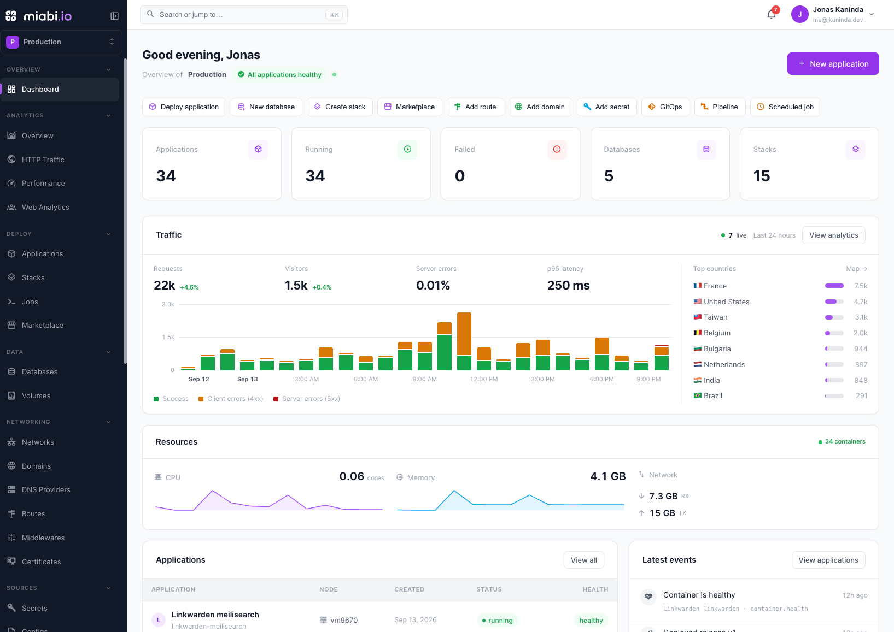
</p>

---

**Miabi** is a developer-first PaaS for deploying and operating containerized applications on your own infrastructure. Push an app — from a **Git repo**, a **Docker image**, or a **marketplace template** — and Miabi handles build, deploy, domains, TLS, databases, scaling, backups, monitoring, and analytics. One web console, one binary, no Docker commands and no Kubernetes cluster.

It runs wherever you already have a server — a VPS, a dedicated server, bare metal, a homelab, or a cloud VM — and everything stays there: the control plane, the data, and the runtime are yours to own, move, and inspect. There is no managed service in the middle and no vendor to leave.

> **The name.** *Miabi* is Tshiluba (Kasai, DR Congo 🇨🇩) for the **muabi trees**, traditionally associated with blessing and growth. It joins the same family as its siblings [Goma Gateway](https://github.com/jkaninda/goma-gateway) and [Posta](https://github.com/goposta/posta).

## Contents

- [Quick Start](#quick-start)
- [Why Miabi](#why-miabi)
- [Who it's for](#who-its-for)
- [Features](#features)
- [Screenshots](#screenshots)
- [How Miabi compares](#how-miabi-compares)
- [Architecture](#architecture)
- [Live Demo](#live-demo)
- [Development](#development)
- [Ecosystem](#ecosystem)
- [Support & contributing](#support--contributing)
- [License](#license)

---

## Quick Start

**Requirements:** a Linux host with a reachable Docker socket, a domain pointing at it, and ports 80/443 free. 2 vCPU and 2 GB run the platform itself; size up for your apps and databases. PostgreSQL and Redis are brought up as part of the stack.

```bash
curl -fsSL https://get.miabi.io | sudo MIABI_DOMAIN=miabi.example.com \
  MIABI_ADMIN_EMAIL=you@example.com bash
```

The script installs Docker if missing, installs the `miabi` CLI, brings up the stack, and prints the admin password. From there:

```bash
sudo miabi system status
sudo miabi system restart
sudo miabi upgrade
sudo miabi system uninstall
```

<details>
<summary><strong>Other install paths</strong> — CLI, no root, Docker Compose</summary>

<br/>

Install the [CLI](https://github.com/miabi-io/cli/releases) and run the same converge yourself:

```bash
sudo miabi setup --domain miabi.example.com --admin-email you@example.com
```

Or use no binary at all. The Miabi image is an installer too, which is the path to take when you **don't have root**:

```bash
docker run --rm -it \
  -v /var/run/docker.sock:/var/run/docker.sock \
  -v /etc/miabi:/etc/miabi \
  miabi/miabi:latest install --domain miabi.example.com --admin-email you@example.com
```

`install`, `upgrade`, `restart`, `status`, and `uninstall` on the image are the same commands as `miabi setup` / `miabi upgrade` / `miabi system …` — [one implementation](./pkg/stack/stackcmd/), two front-ends, so neither can drift from the other. Either way the converge is idempotent: re-run it and only what changed is recreated.

Prefer to drive Compose yourself? [`examples/compose/`](./examples/compose/) brings up the same stack.

</details>

Full options, the `/etc/miabi/miabi.yaml` manifest, the built-in registry, and custom gateway config are in the **[installation docs](https://docs.miabi.io/docs/getting-started/installation)**. Already running containers on the server? See **[install on a server you already use](https://docs.miabi.io/docs/getting-started/existing-server)**.

---

## Why Miabi

**Docker Compose isn't enough** for production: no rolling updates, no rollback, no TLS, no multi-tenancy. **Kubernetes is overkill**: a service mesh just for canary, Argo CD or Flux just for GitOps, and a platform team to keep it running.

Miabi sits in the middle — production deployment strategies on plain Docker, with the pieces you actually need built in rather than assembled.

Three things set it apart from other self-hosted PaaS options:

**Multi-tenancy from day one.** Most self-hosted PaaS tools assume one operator and one set of apps. Miabi is built around **workspaces**: every app, database, domain, volume, registry image, secret, backup, and deployment belongs to one. That makes it workable for shared hosting providers, agencies running client apps, SaaS platforms, internal developer platforms, and universities — not just single-tenant homelabs.

**Deployment strategies without a mesh.** Rolling and canary deployments with weighted traffic splitting, rollbacks, and zero-downtime updates, on Docker, because routing already flows through [Goma Gateway](https://github.com/jkaninda/goma-gateway).

**Analytics with zero instrumentation.** Every request already passes through the gateway, so every app gets HTTP traffic, latency, and privacy-first web analytics with no JS snippet, no SDK, and no code change.

Everything in the console is also in the REST API, the CLI, and the Terraform provider. Run it on a VPS, dedicated server, bare metal, homelab, or cloud. No vendor lock-in, no managed control plane.

---

## Who it's for

| You are | What you get | Guide |
| --- | --- | --- |
| A solo developer or homelabber | Deploy and manage your applications on your own server, VPS or homelab | [One server](https://docs.miabi.io/docs/use-cases/single-node) · [Homelab](https://docs.miabi.io/docs/use-cases/homelab) |
| A startup or company | A private application platform for your teams, with GitOps, SSO and isolated environments | [Teams and companies](https://docs.miabi.io/docs/use-cases/teams) |
| A hosting provider or MSP | Your own multi-tenant hosting platform, with customer workspaces, plans and quotas; white-label branding and premium tiers come with a Service Provider license | [Hosting providers and agencies](https://docs.miabi.io/docs/use-cases/hosting-providers) |
| A platform serving several organizations (Enterprise) | Organizations with their own users, sign-in and dedicated infrastructure | [Several organizations](https://docs.miabi.io/docs/use-cases/multiple-organizations) |
| A university or training provider | Isolated application environments for students, courses and training programs | [Universities and training](https://docs.miabi.io/docs/use-cases/education) |

It grows from one server to a cluster to several regions without a reinstall. See **[all use cases](https://docs.miabi.io/docs/use-cases/overview/)**.

---

## Features

### Applications & deployments

- Deploy from a **Git repo**, a **Docker image**, or a **marketplace template**; buildpacks build repos without a Dockerfile
- **Releases** with one-click **rollback**, **zero-downtime** rolling updates, and **canary** releases with weighted traffic splitting
- **Environments** — promotion between stages, with approval gates
- **Jobs** — one-off commands in an app's runtime, plus declarative `Job` and `CronJob` manifests
- **Stacks** — groups of apps, importable from a `docker-compose.yml`
- **GPUs** — cards allocated per app or job, GPU-aware placement, and GPU settings kept on Docker Compose import
- Env vars, a workspace **secret vault**, per-app **resource limits**, and a **timeline** of lifecycle events
- **Built-in container registry**, namespaced per workspace, on local storage or S3/MinIO (Enterprise):
  ```bash
  docker login <registry> -u <workspace-name> -p <api-token>
  ```

### Domains, networking & TLS

- **Domains** with DNS-verified ownership and workspace-owned **middlewares**, routed through Goma Gateway
- **Automatic TLS** — HTTP-01 by default, **wildcard / DNS-01** through a connected DNS provider, or uploaded **custom certs**
- **An isolated network per workspace**, drawn from a managed pool so a busy host never runs out of Docker networks
- Per-node **edge gateways** and on-demand **port forwarding** to managed databases

### Data, storage & backups

- **Databases** — PostgreSQL, MySQL, MariaDB, Redis, libSQL and MongoDB, with managed credentials, in-place **version upgrades**, and `DatabaseInstance` manifests
- **Volumes** — node-local by default, or **shared**: NFS, CIFS/SMB, or a storage class on a filesystem every node mounts, such as CephFS, so a service fails over to another node with its data
- **Backups** — scheduled and manual backups and restores of databases and volumes to **local, MinIO or S3**; console backups and restores run in the background and notify you when they finish
- **Portable workspace backups** — a whole workspace in one bundle, sealed with a passphrase when one is set, restorable on any install
- **Workspace migration** — move a workspace and its data to another Miabi install
- **Platform backup** (Enterprise) — back up and restore the control plane itself

### Multi-node & clustering

- **Nodes** — the [node agent](https://github.com/miabi-io/agent) dials out to the control plane, so a node works behind NAT and firewalls
- **Cluster mode** — optional Docker Swarm with encrypted overlay networks; apps run as replicated services and move off a failed node
- **Several clusters as locations** — one control plane drives clusters in other regions or sites, each serving its traffic through its own gateway; workspaces pick a location
- **Placement** — pin an app, database, volume or job to a node by name; node pools and Enterprise plan placement keep a plan's workspaces on its own hardware
- **Live migration between locations** (Enterprise) — an app with its volumes and databases, with near-zero downtime
- **Docker import** of existing containers, volumes and networks, and **housekeeping** that reconciles drift and reclaims disk

### CI/CD & GitOps

- **Pipelines** as code, run on dedicated **build runners** that keep build load off app nodes
- **GitOps** — pull-based reconciliation from `miabi.io/v1` manifests, or a one-shot `miabi apply` with dry-run, diff and prune; no Argo CD or Flux to run
- **Git push deploy**, stored Git and registry credentials, signed **webhooks**, and **notifications**
- **[Examples](https://github.com/miabi-io/examples)** — complete CI/CD and GitOps for Node.js, Go, Python, PHP, Laravel, Java and Spring Boot apps, deployable as-is
- REST + OpenAPI everywhere, a **CLI**, a [Terraform / OpenTofu provider](https://github.com/miabi-io/terraform-provider-miabi), and **`miabi mcp`**, which exposes the platform to AI agents, read-only by default

### Identity, teams & access

- **Sign-in** — email or username, **2FA (TOTP)**, **passkeys**, API tokens and **service accounts**
- **SSO** — OAuth 2.0 / OIDC (GitHub, Google, any OIDC provider); Enterprise adds **SAML 2.0**, **SCIM** and **LDAP / Active Directory**, with directory groups mapped to roles
- **Workspaces and organizations** — members and invitations; organizations are tenant realms with their own owner, workspace cap, SSO provider and, optionally, **dedicated locations**
- **RBAC** — **Owner · Admin · Developer · Viewer**; Enterprise adds custom roles and per-resource policies
- **Restricted container profile** — app and job containers run as an unprivileged UID with `no-new-privileges`
- **Plans & quotas**, per-workspace **encryption keys** with rotation and crypto-shred on delete, and **sealed secrets** safe to commit to Git

### Monitoring, analytics & operations

- Container and workspace **metrics** with history, **Prometheus** integration, and health endpoints
- **Analytics with no instrumentation** — traffic, p50/p95/p99 latency split between gateway and app, error rate, Apdex, and cookieless web analytics; IPs are never stored
- **Alerts and notifications** — a per-user inbox for failed deploys, finished backups and other events
- **Logs** — deployment, pipeline, job and backup logs kept with retention and full download, plus live tailing
- **Audit log** of every change, streamed to a **SIEM** over syslog or webhook (Enterprise)
- **Admin platform** — nodes, clusters, organizations, users, plans, settings, SSO and license
- **The console in 10 languages** — English, French, German, Spanish, Italian, Portuguese, Simplified and Traditional Chinese, Japanese and Korean, chosen per user

### Marketplace

More than 50 official, versioned templates: databases (PostgreSQL, MySQL, MongoDB, Redis, Valkey), Git (Gitea, Forgejo, GitLab), monitoring (Grafana, Uptime Kuma, Umami, Matomo), identity (Keycloak, authentik, Vaultwarden), AI (Open WebUI, Qdrant), and apps such as WordPress, Ghost, Nextcloud and n8n. Browse them at **[marketplace.miabi.io](https://marketplace.miabi.io/)**.

---

## Screenshots

<table>
  <tr>
    <td width="50%" align="center"><strong>Deploy an application</strong><br/>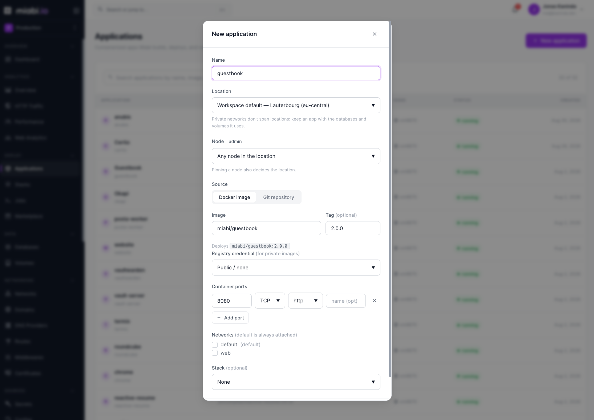</td>
    <td width="50%" align="center"><strong>Canary deployment</strong><br/>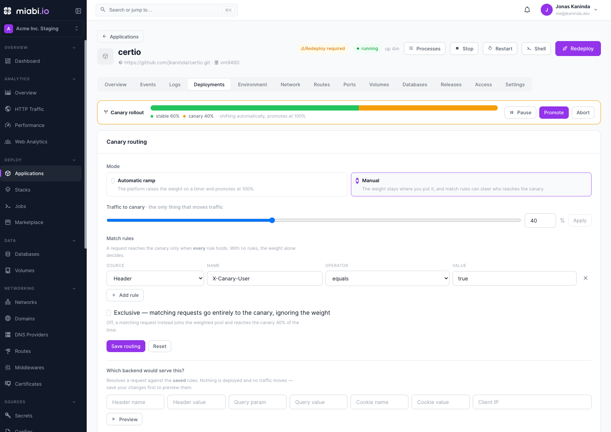</td>
  </tr>
  <tr>
    <td width="50%" align="center"><strong>GitOps</strong><br/>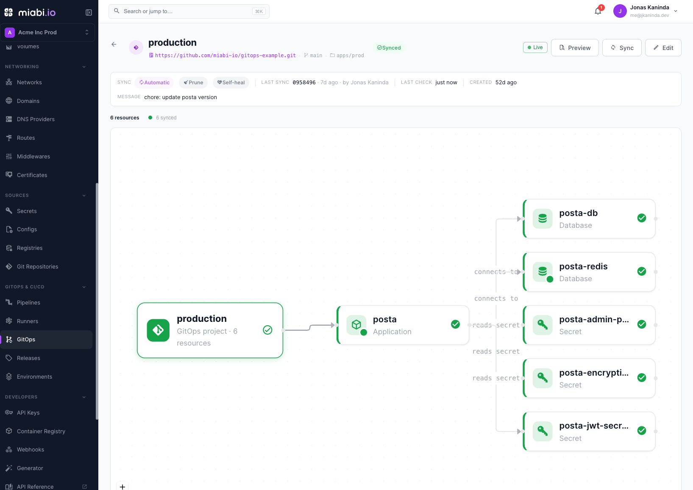</td>
    <td width="50%" align="center"><strong>Analytics</strong><br/>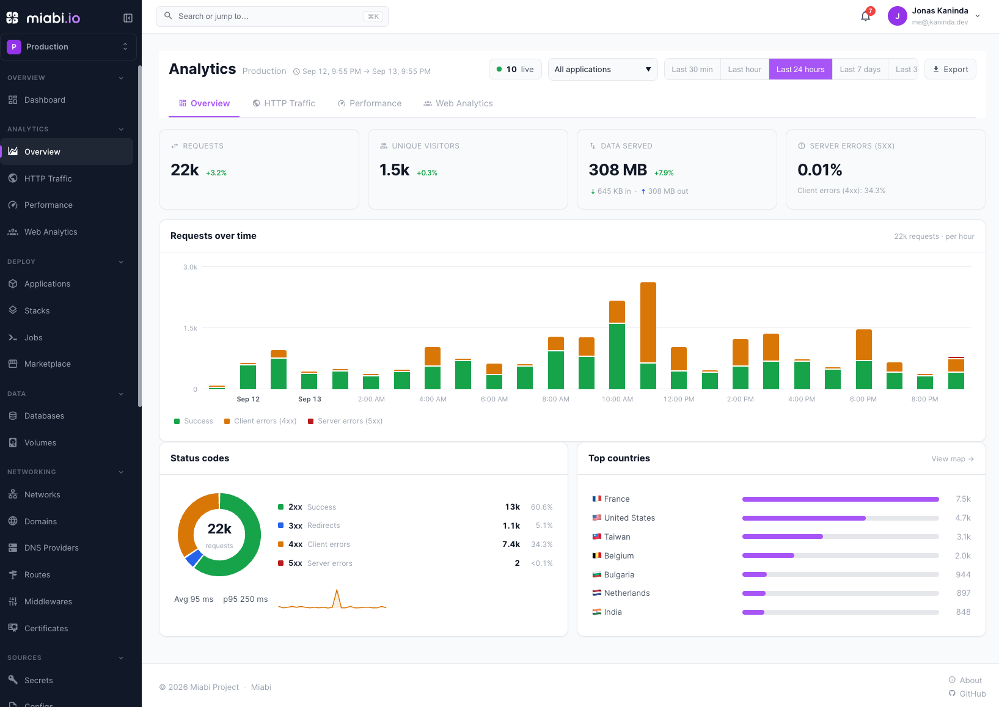</td>
  </tr>
  <tr>
    <td width="50%" align="center"><strong>Nodes &amp; cluster</strong><br/>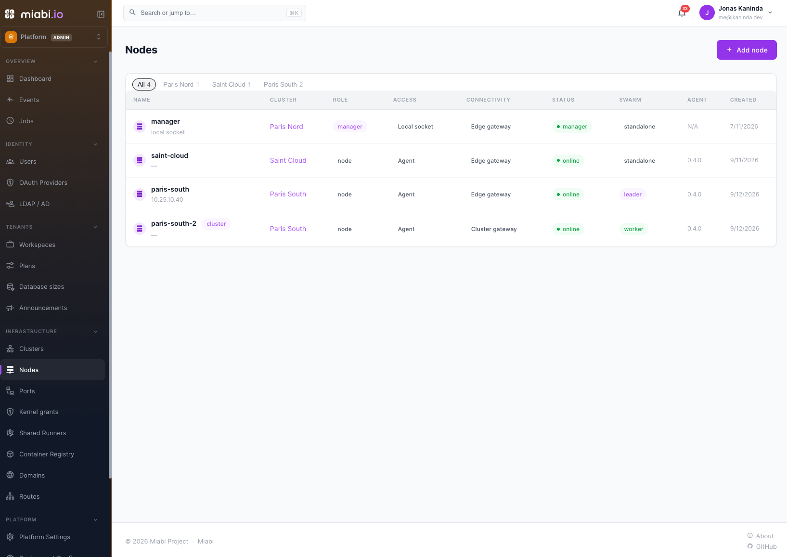</td>
    <td width="50%" align="center"><strong>Managed databases</strong><br/>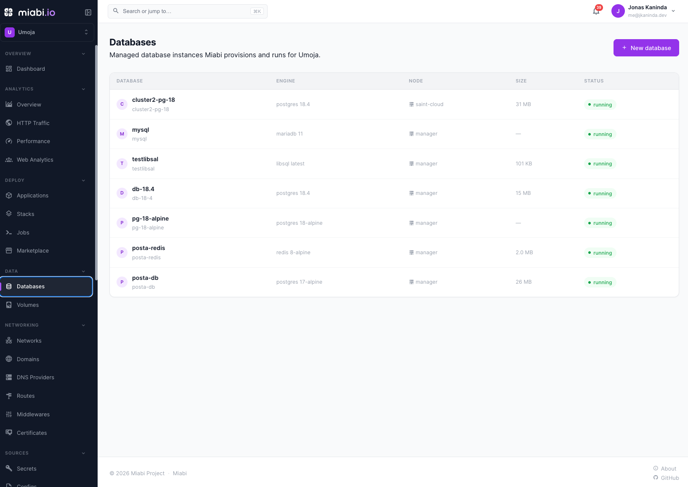</td>
  </tr>
</table>

<details>
<summary>More screenshots — pipelines, domains, backups, monitoring, marketplace, admin</summary>

<table>
  <tr>
    <td width="50%" align="center"><strong>CI/CD pipelines</strong><br/>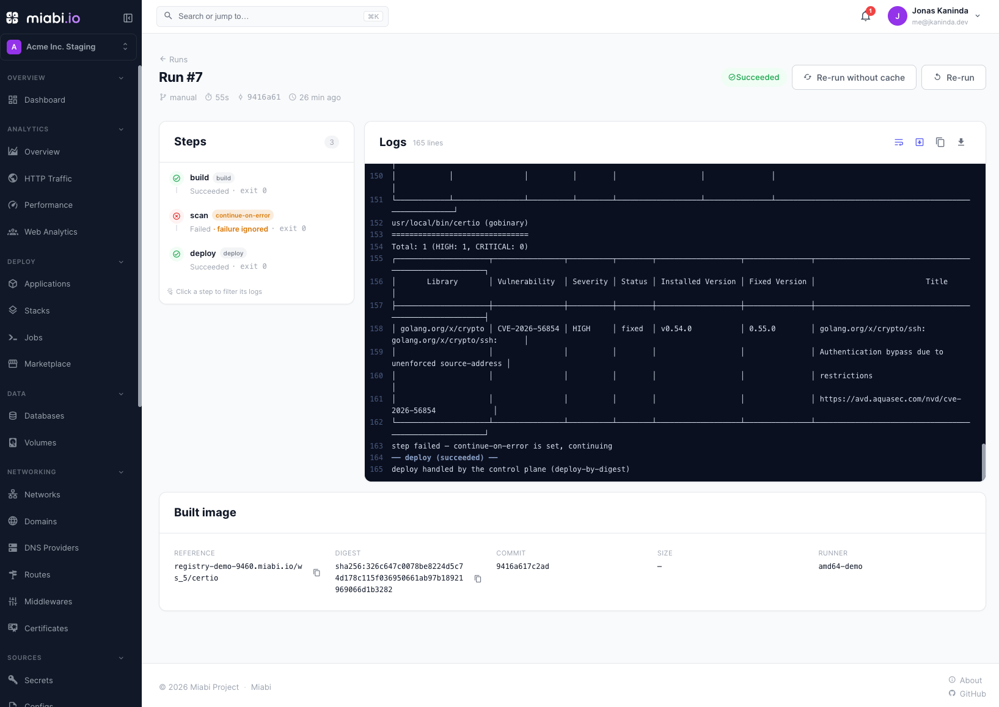</td>
    <td width="50%" align="center"><strong>Domains, routes &amp; TLS</strong><br/>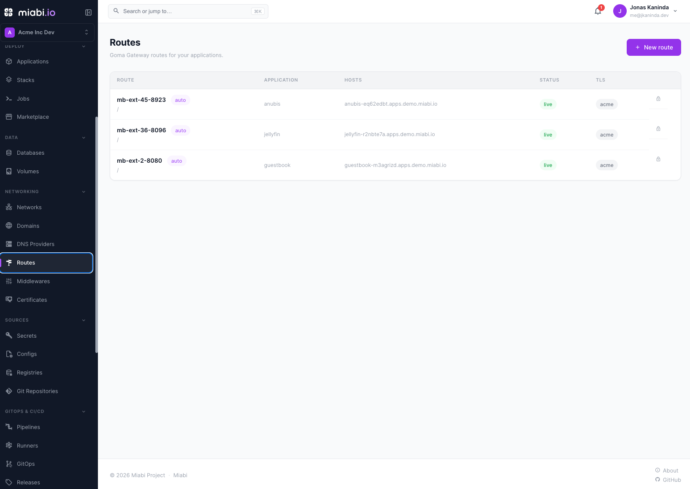</td>
  </tr>
  <tr>
    <td width="50%" align="center"><strong>Backups</strong><br/>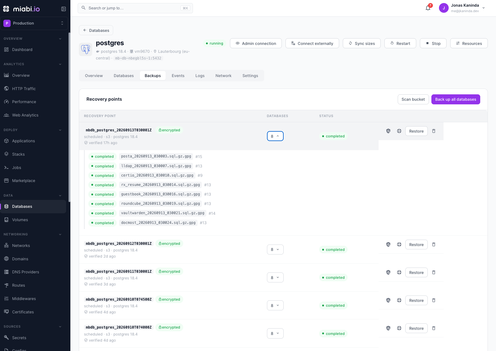</td>
    <td width="50%" align="center"><strong>Monitoring</strong><br/>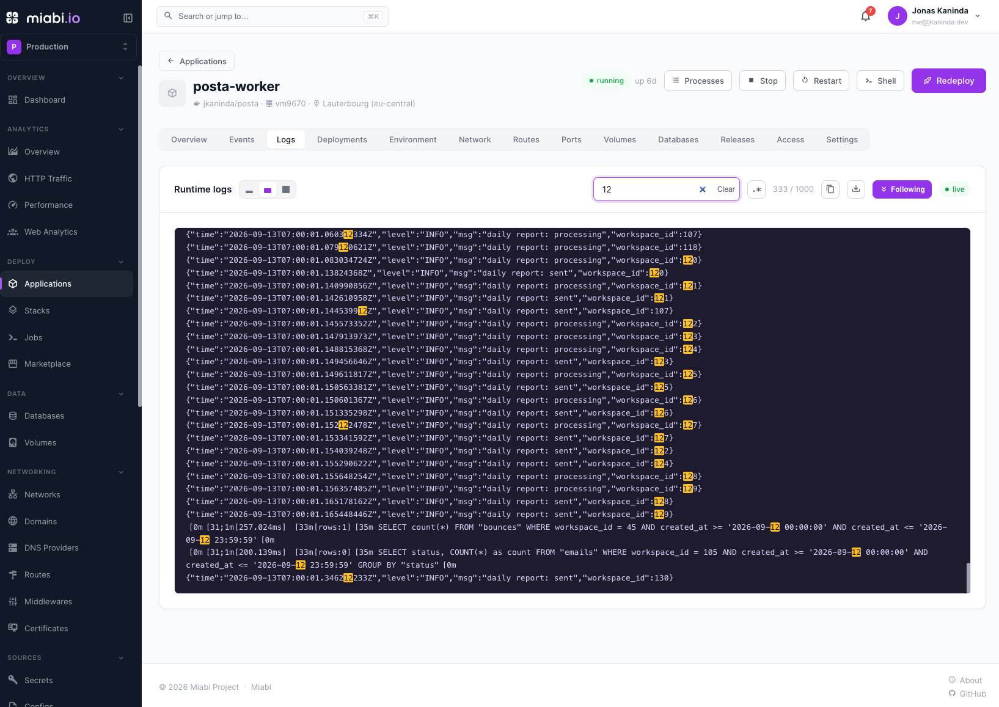</td>
  </tr>
  <tr>
    <td width="50%" align="center"><strong>Marketplace</strong><br/>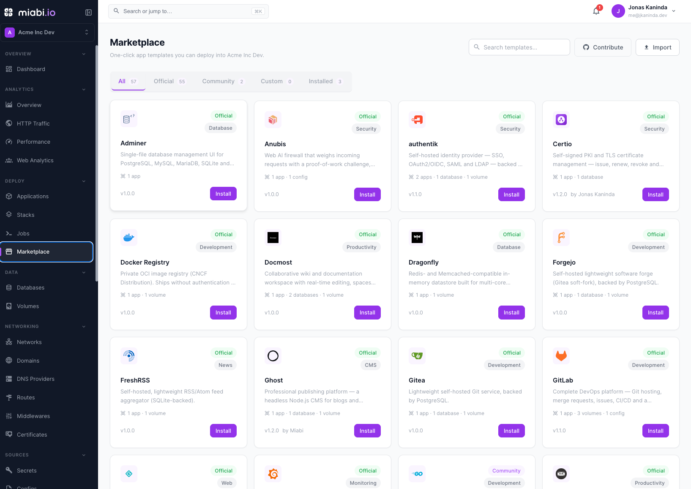</td>
    <td width="50%" align="center"><strong>Platform admin</strong><br/>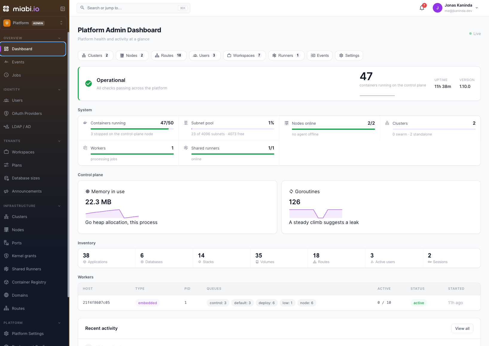</td>
  </tr>
  <tr>
    <td width="50%" align="center"><strong>Application overview</strong><br/>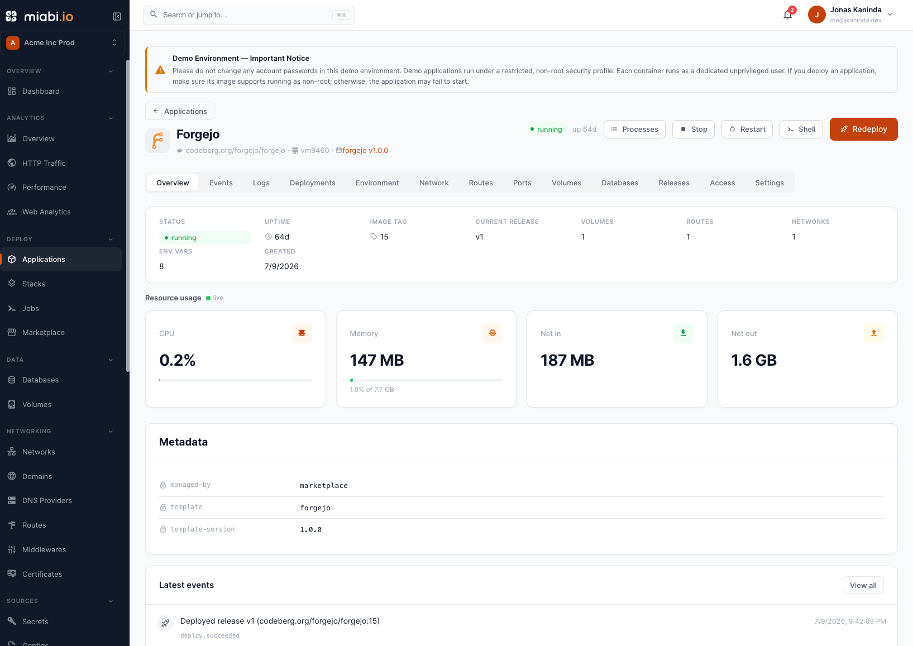</td>
    <td width="50%" align="center"><strong>HTTP traffic analytics</strong><br/>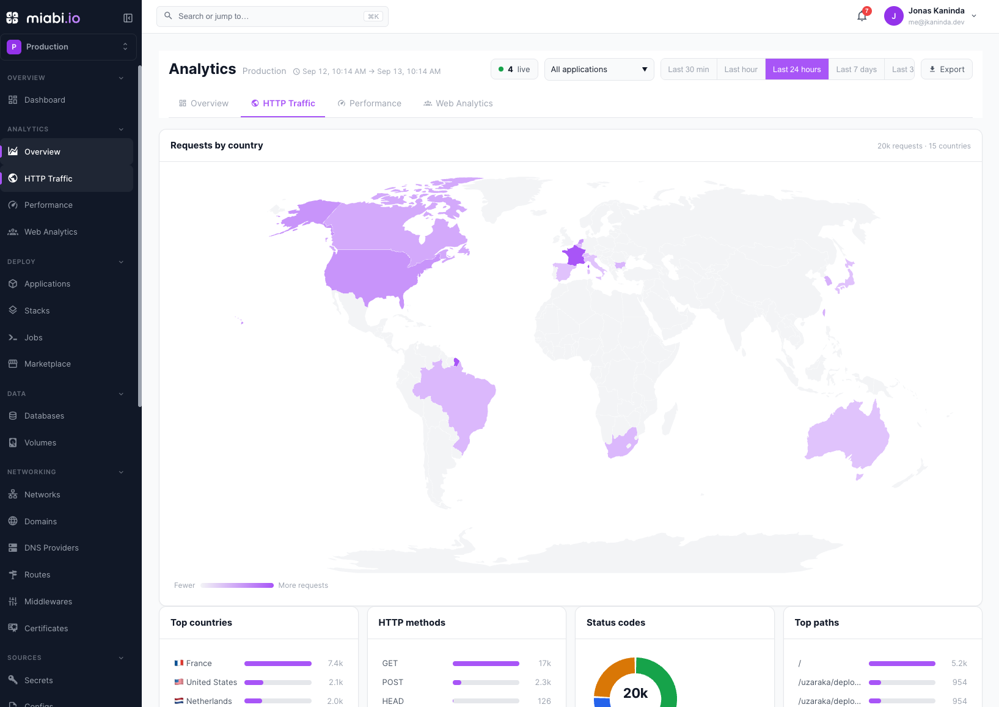</td>
  </tr>
</table>

</details>

---

## How Miabi compares

All four projects are self-hosted, open source, and deploy from Git or a Docker image with automatic HTTPS. The table covers only where they differ.

| Feature | Miabi | Coolify | Dokploy | CapRover |
| --- | :---: | :---: | :---: | :---: |
| Multi-tenancy & shared hosting (isolated workspaces) | ✅ | ❌ | ❌ | ❌ |
| Organizations, teams & RBAC | ✅ | Limited | ❌ | ❌ |
| Canary deployments | ✅ | ❌ | ❌ | ❌ |
| Zero-downtime deployments | ✅ | Limited | Limited | Limited |
| Built-in CI/CD pipelines | ✅ | ❌ | ❌ | ❌ |
| GitOps (no extra controller) | ✅ | ❌ | ❌ | ❌ |
| Declarative manifests (`miabi apply`) | ✅ | ❌ | ❌ | ❌ |
| Built-in container registry | ✅ | ❌ | ❌ | ❌ |
| Secret vault (references, rotation redeploys apps) | ✅ | Partial | Partial | ❌ |
| Sealed secrets (encrypted, safe to commit to Git) | ✅ | ❌ | ❌ | ❌ |
| Built-in analytics (privacy-first) | ✅ | ❌ | ❌ | ❌ |
| Audit logs | ✅ | ❌ | ❌ | ❌ |
| OpenAPI-documented REST API | ✅ | ❌ | Partial | Limited |
| Official CLI | ✅ | ❌ | ❌ | ❌ |
| Terraform provider | ✅ | ❌ | ❌ | ❌ |
| Multi-node deployments | ✅ | Partial | Partial | Partial |
| Multiple clusters & regions | ✅ | ❌ | ❌ | ❌ |
| Live migration between locations (app, volumes & databases, near-zero downtime) | ✅ (Enterprise) | ❌ | ❌ | ❌ |
| Docker import (adopt existing containers) | ✅ | ❌ | ❌ | ❌ |
| Scheduled backups | ✅ | Partial | Partial | ❌ |
| Portable workspace backups (whole workspace, passphrase-sealed, restore anywhere) | ✅ | ❌ | ❌ | ❌ |
| Workspace migration to another install, with data | ✅ | ❌ | ❌ | ❌ |
| SAML / LDAP | ✅ (Enterprise) | ❌ | ❌ | ❌ |

> Compiled from each project's public documentation. These projects move fast — if something here is out of date, please [open a PR](https://github.com/miabi-io/miabi/pulls) and we'll correct it.

---

## Architecture

```
Browser / CLI / API clients
        │
        ▼
Goma Gateway (routing, TLS/ACME)
        │
        ▼
Miabi control plane (single Go binary: REST API + embedded Vue console)
        │
        ├─ asynq worker ── deploys, provisioning, backups
        ├─ PostgreSQL (GORM) · Redis (cache/queue)
        │
        ▼
Clusters (Docker Engine, optional Swarm per cluster)
        ├─ default cluster ── local socket, plus its Swarm members
        ├─ standalone nodes ── outbound agent tunnel, own edge gateway
        └─ remote Swarm clusters ── managers via agent tunnel, own ingress gateway
```

| Layer | Technology |
| --- | --- |
| Backend | Go 1.27+, [Okapi](https://github.com/jkaninda/okapi) framework, REST + OpenAPI |
| Frontend | Vue 3 + Pinia + Vite, built and statically served by the binary |
| Database | PostgreSQL (GORM) |
| Queue / cache | Redis + Asynq |
| Runtime | Docker Engine 25+ via the Moby SDK for Go (`moby/moby/client`), optional Swarm |
| Reverse proxy / TLS | [Goma Gateway](https://github.com/jkaninda/goma-gateway) |
| Metrics | Prometheus |

The console source lives in [`web/`](./web/) and is embedded into the Go binary, so a deployment is a single image. The node agent is a separate module, [`github.com/miabi-io/agent`](https://github.com/miabi-io/agent): a thin Docker proxy that needs only an outbound connection and the local Docker socket.

---

## Live Demo

Try Miabi without installing anything at **<https://demo.miabi.io>** (password for all accounts: `MiabiDemo2026`).

The demo is seeded with **two independent customers across three workspaces**, so the core idea is visible immediately: shared hosting on Docker with true workspace isolation and role-based access. Every app, database, domain, volume, and secret belongs to a workspace; one tenant can never see or reach another's resources; a member only sees what their role grants.

| Sign in as | Workspaces | Role | Represents |
|------------|------------|------|------------|
| `admin@acme.demo.miabi.io` | **Acme Inc Prod** · **Acme Inc Dev** | Owner | one org running prod and dev in separate, isolated workspaces |
| `dev@acme.demo.miabi.io` | **Acme Inc Dev** | Developer | a teammate scoped to a single workspace — can't see Acme Inc Prod |
| `admin@startup.demo.miabi.io` | **Startup Prod** | Owner | a different tenant — invisible to Acme |

Switch workspaces from the picker to watch the console re-scope, then sign in as the other customer to confirm the isolation boundary.

> [!IMPORTANT]
> These are **workspace accounts, not the platform admin.** They can't reach the admin platform (nodes/cluster, users, plans, settings, licensing). To explore platform-admin features, [install Miabi](#quick-start) — the first account you seed is the platform admin.

> [!NOTE]
> Demo apps run under a **restricted (non-root) security profile**: each container runs as a dedicated unprivileged user. If you deploy an app, make sure its image can run as non-root, or it will fail to start.

---

## Development

Building from source needs **Go 1.27+**, Node (for the console), a PostgreSQL and a Redis instance, and a reachable Docker socket.

```bash
git clone https://github.com/miabi-io/miabi.git
cd miabi

make run        # API server on :9000, worker embedded
make worker     # standalone background worker (optional)
make build-ui   # build the Vue console into the embedded assets
make test       # unit + integration tests
```

The OpenAPI spec is generated from code annotations in [`internal/routes/`](./internal/routes/) and served at `/docs` and `/openapi.json` on any running instance.

---

## Ecosystem

Miabi is part of a family of self-hosting tools by the same author:

| Project | What it is |
| --- | --- |
| [Okapi](https://github.com/jkaninda/okapi) | The Go web framework Miabi is built on |
| [Goma Gateway](https://github.com/jkaninda/goma-gateway) | Reverse proxy with TLS/ACME |
| [cli](https://github.com/miabi-io/cli) | The official CLI |
| [terraform-provider-miabi](https://github.com/miabi-io/terraform-provider-miabi) | Terraform / OpenTofu provider |
| [agent](https://github.com/miabi-io/agent) | Outbound node agent for multi-node |
| [runner](https://github.com/miabi-io/runner) | Dedicated build and pipeline runner |
| [marketplace](https://github.com/miabi-io/marketplace) | Official app template catalog |
| [examples](https://github.com/miabi-io/examples) | Example apps with complete CI/CD pipelines and GitOps manifests |
| [Posta](https://github.com/goposta/posta) | Self-hosted email delivery and inbound |
| [pg-bkup](https://github.com/jkaninda/pg-bkup) · [mysql-bkup](https://github.com/jkaninda/mysql-bkup) · [mongodb-bkup](https://github.com/jkaninda/mongodb-bkup) · [libsql-bkup](https://github.com/jkaninda/libsql-bkup) · [volume-bkup](https://github.com/jkaninda/volume-bkup) | Backup tools for databases and volumes |

---

## Support & contributing

- **Docs** — <https://docs.miabi.io>
- **Use cases** — [one server to several regions, teams to hosting providers](https://docs.miabi.io/docs/use-cases/overview/)
- **Questions & ideas** — [GitHub Discussions](https://github.com/miabi-io/miabi/discussions)
- **Bugs & features** — [open an issue](https://github.com/miabi-io/miabi/issues). External pull requests are not accepted at the moment; see [CONTRIBUTING.md](./CONTRIBUTING.md)
- **Security** — report vulnerabilities privately to <security@miabi.io>. Please don't file public issues for security problems

If Miabi is useful to you, starring the repo genuinely helps other people find it.

---

## License

| Path | License |
| --- | --- |
| Core | **AGPL-3.0-or-later** — [LICENSE](./LICENSE), [NOTICE](./NOTICE) |
| [`pkg/`](./pkg) | **Apache-2.0** — [`pkg/LICENSE`](./pkg/LICENSE) |
| [`internal/enterprise/`](./internal/enterprise) | **Miabi Enterprise License** — [LICENSE.md](./internal/enterprise/LICENSE.md) |

The reusable packages under `pkg/` are the importable half of the project (`pkg/stack` is the host installer and lifecycle engine the CLI drives), so embedding them carries no AGPL obligation — nothing under `pkg/` depends on AGPL-licensed code.

Enterprise features are built with the `enterprise` tag and require a valid commercial license. [LICENSING.md](./LICENSING.md) has the full breakdown.

Miabi's code is open source. Its name is not.
The Miabi name and logos are not covered by these licenses.

Copyright © 2026 Jonas Kaninda